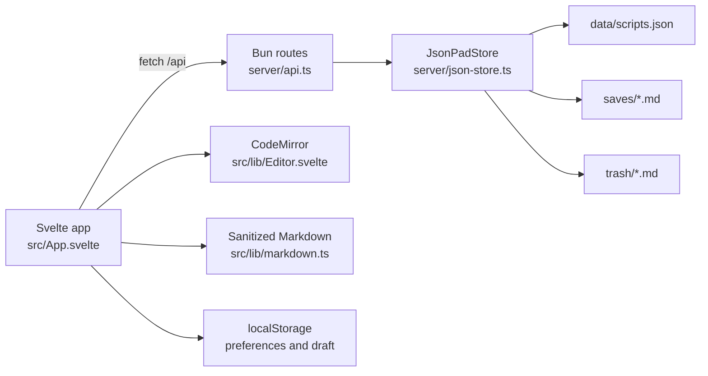

# Rune codebase

Rune is a local Markdown writing app. Svelte renders the library and editor, CodeMirror handles writing, and a Bun server stores scripts as Markdown files. The browser talks to the server through `/api`; it does not write directly to the filesystem.

## How the pieces connect

`src/main.ts` mounts `src/App.svelte` and loads `src/style.css`. `App.svelte` owns the library, active file, dialogs, keyboard shortcuts, save status, and client-side preferences. Its `request()` helper calls the Bun API. The API validates requests and passes storage operations to `JsonPadStore`.

## Source map

| Path | Responsibility |
| --- | --- |
| `src/App.svelte` | Sidebar, dashboard, editor shell, Trash, backup controls, sorting, state restoration, autosave, and keyboard shortcuts. |
| `src/lib/Editor.svelte` | CodeMirror Markdown editor, syntax highlighting, selection and formatting commands. Sends content changes to `App.svelte`. |
| `src/lib/markdown.ts` | Renders Read mode and Trash previews with `markdown-it` and sanitizes HTML with DOMPurify. |
| `src/lib/file-names.ts` | Shared filename validation used by the UI and storage layer. |
| `src/lib/live-preview.ts` | CodeMirror decorations for the Write-mode Markdown preview. |
| `src/lib/types.ts` | Shared `Pad` and `TrashedPad` shapes and word count. |
| `src/style.css` | Theme variables, layout, responsive styles, and component styling. Later rules override some earlier styles. |
| `server/index.ts` | Starts the Bun server, chooses the data file, routes `/api`, and serves `dist/` in a built app. |
| `server/desktop.ts` / `scripts/build-desktop.ts` | Compiles the API and frontend assets into a Bun executable embedded in the Tauri Windows application. |
| `src-tauri/src/lib.rs` | Extracts and starts the embedded server, opens the desktop window, focuses an existing instance on relaunch, and stops the server on exit. |
| `server/api.ts` | HTTP routes, input checks, same-origin checks for writes, and error responses. |
| `server/json-store.ts` | File naming, reads and writes, revisions, Trash, backup import/export, and old data migrations. |
| `scripts/dev.ts` / `vite.config.ts` | Starts Bun on port 3001 and Vite on port 4173; Vite proxies `/api` to Bun. |
| `public/` | Valknut favicon and logo artwork plus bundled iA Writer Mono fonts. |
| `tests/` | Storage/API and Markdown sanitization tests. |

## Current user flows

- **Library:** Files appear as cards or a list. Search matches titles and content. Users can pin, rename, delete, and sort by edit date, creation date, title, or recently opened order. The sidebar puts recently opened files first.
- **Writing:** Opening a file loads it into CodeMirror. Write, Read, and focus modes are available. Read mode renders sanitized Markdown. Read/Write choice is remembered per file.
- **Saving:** Changes update the local view immediately and trigger a save after 650 ms. The client sends the current revision with `PUT /api/pads/:id`; the store increments it on success and rejects stale revisions. Navigation waits for pending changes to save. An unsaved draft is also kept in browser storage for recovery after a reload.
- **Trash:** Deleting moves a Markdown file to `trash/`. Users can preview it without restoring, restore it, select files for permanent deletion, or empty Trash.
- **Moving or recovering work:** The sidebar's Backup dialog downloads one JSON archive containing active files and Trash. Import adds copies with new IDs and leaves the current library untouched. The editor can export an individual `.md` file. The app reports when a download starts or when preparation fails; the browser does not report when the download finishes writing to disk.

## Data and browser state

By default, the server writes active content to `saves/<title>.md`, deleted content to `trash/<title>.md`, and metadata to `data/scripts.json`. New and renamed files must have unique, filename-safe titles across the library and Trash. Automatic new files and restored backup copies get a numbered title when needed. Existing legacy titles are left intact until renamed. The metadata file is version 3 and holds IDs, titles, filenames, pin state, revisions, and timestamps; content stays in the Markdown files. `JsonPadStore.open()` reads the index and files at startup and migrates supported older layouts. Store writes use temporary files and rename them into place. Mutations are serialized within one server process.

`RUNE_DATA_FILE` can point to a different index file. `LIBRETTO_DATA_FILE` and `CARETI_DATA_FILE` remain accepted as legacy alternatives. The `saves/` and `trash/` directories are derived from the index location. Run only one server process per data file. The data directories, `dist/`, and `node_modules/` are ignored by Git; they are not part of the repository.

The browser uses `localStorage` for the current file, theme, layout, filter, search, sort choice, sidebar state, recent file order, and per-file Read/Write modes (`rune-state-v1`). It also keeps a pending draft under `rune-draft-v1` until a save succeeds. These browser settings and drafts are separate from the JSON backup. The server's files are the durable library; a backup file should be kept outside the device for device loss or migration.

The Windows desktop build stores its library in `%LOCALAPPDATA%/app.rune.editor/`. It embeds a compiled Bun server and all frontend assets, extracts the server to that directory, and serves the WebView at `http://127.0.0.1:43187`. A stable origin keeps preferences and drafts available across launches. A single-instance plugin prevents concurrent desktop processes from writing the same library; closing Rune stops the child server, and closing the parent stdin pipe also causes the child to exit. Desktop builds use `bun run build:desktop`; `bun scripts/smoke-desktop.ts` checks the compiled server with an isolated temporary library.

## HTTP API

| Route | Use |
| --- | --- |
| `GET /api/health` | Server health. |
| `GET /api/pads`, `POST /api/pads` | List or create active files. |
| `GET /api/pads/:id`, `PUT /api/pads/:id`, `DELETE /api/pads/:id` | Read, save, or move a file to Trash. |
| `GET /api/pads/:id/export` | Download saved Markdown content. |
| `GET /api/trash`, `DELETE /api/trash` | List or empty Trash. |
| `POST /api/trash/:id/restore`, `POST /api/trash/delete` | Restore one file or permanently delete selected IDs. |
| `GET /api/backup`, `POST /api/backup` | Download or import a full-library JSON backup. |

The API validates IDs and write payloads. A single script is limited to 2 MB of content; backup imports are limited to about 50 MB. The server binds to `127.0.0.1` by default. If exposed beyond the local machine, it would need an authentication layer.

## Run and verify

Install dependencies with `bun install`, then use `bun run dev` and open `http://127.0.0.1:4173`. For a production bundle, run `bun run build`, then `bun start` and open `http://127.0.0.1:3001`. `PORT`, `HOST`, and the optional data-file setting are shown in `.env.example`.

Run `bun run check` for Svelte and TypeScript diagnostics and `bun test` for the storage/API and Markdown tests. `bun run build` confirms the client bundles successfully.

## Contributor notes

- Keep reusable visual rules and spacing tokens in `src/style.css`; the padding preference scales the compact layout. Check narrow windows, keyboard focus, dark mode, and the editor when changing styles.
- File titles become filenames. Validate them in the shared helper and enforce uniqueness inside the store's serialized mutation, not just in the browser. Trash reserves its names. Never overwrite unrelated files in the chosen storage folder. Backup restore assigns distinct safe titles to imported copies.
- The editor stores Markdown source, not rendered HTML. Live-preview decorations may hide syntax, but must never mutate the document or break editing, selection, copy/paste, or undo.
- Use the existing HTML dialogs and notices for user-facing decisions and errors. Preserve confirmation for destructive actions.
- Before submitting changes, run `bun run check`, `bun test`, and `bun run build`. Add focused tests for behavioral changes, especially storage mutations and recovery.
